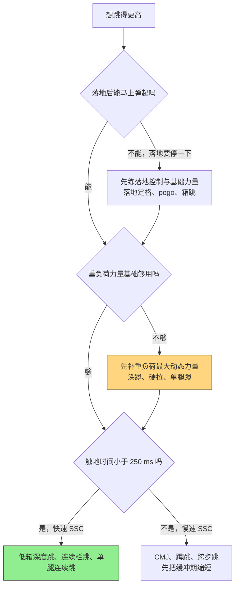
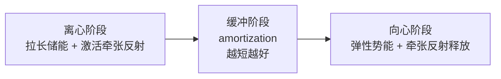

前几天看了拓得时代那篇《深蹲200公斤，为什么还是跳不高？》[^1]，正好把我想整理很久的超等长训练串起来了。这篇主要按 NSCA《Essentials of Strength Training and Conditioning》（也就是 CSCS 教材）里增强式训练那一章的框架来整理，再补上那篇文章引用的五类力量分类，算自己的一份笔记。

先把结论放前面：**深蹲的 1RM 和纵跳高度不是同一项能力**。深蹲回答的是「重的东西能不能动」，弹跳回答的是另外几件事：能不能在很短的时间里发力、能不能在一次动作里把力量用完、落地之后能不能马上接回来。力量是基础，但基础不等于成品。

---

### 1. 先把术语说清楚：plyometric / 超等长 / 增强式

这几个词指的是同一个东西，国内译法一直不统一：

- **超等长训练**：力量和体能领域更常见的叫法
- **快速伸缩复合训练**：体育院校教材里常用
- **增强式训练**：另一套常见译名
- 英文原文都是 **plyometric training**

它的机制核心是**超等长收缩**，也就是**拉长—缩短循环**（Stretch-Shortening Cycle，SSC）：肌肉—肌腱先被快速拉长（离心），再立刻缩短（向心），利用储存的弹性势能和牵张反射，产生比单纯向心收缩更大的力量输出。

这里的关键词不是「跳」，而是**快**。拉长到缩短之间的切换一旦变慢，动作就退化成普通的力量动作，练的就不是超等长了。

目标能力也很明确：**爆发力量（RFD）和反应力量（RSI）**，不是肌肥大。想练大肌肉，超等长不是好工具；想把已有的力量在极短时间内兑现出来，它才是。

---

### 2. 「力量好」其实有五种，深蹲只回答了其中一种

James 等人在 2023 年的文章里，把常见的「力量」分成五类[^2]。这张表我觉得很值得贴在训练日志第一页：

| 力量类型 | 回答的问题 | 常见测试/例子 |
|---|---|---|
| 最大等长力量 Maximal Isometric Strength | 身体不动时，最多能顶出多大力量 | 等长深蹲、IMTP、推墙 |
| 爆发力量 Explosive Strength | 动作刚开始时，力量来得有多快 | RFD、短跑起跑、快速出拳 |
| 重负荷最大动态力量 Heavy Maximal Dynamic Strength | 负荷很重时，能不能完成一次动作 | 深蹲/卧推/硬拉 1RM |
| 快速最大动态力量 Fast Maximal Dynamic Strength | 一次完整的快速动作能做多好 | 反向纵跳（CMJ）、原地蹲跳 |
| 反应力量 Reactive Strength | 落地后，能不能在很短时间内再次发力 | 深度跳、反弹跳、RSI |

几个容易混的点：

- **深蹲 200 kg 主要证明的是第三项**。它能给冲刺、跳跃、对抗提供基础，但它不替任何人回答「力能不能马上出来」。
- **爆发力量和快速最大动态力量不是一回事**。前者像快门按下的那一瞬间发生了什么，研究中常用 RFD（力发展率）观察，常见窗口大约 0.030–0.150 秒；后者看整段动作最终交出的结果，比如跳了多高。
- **反应力量还多一道门槛**：先落地、先吸收冲击，再看能不能立刻把力量送回地面。
- **别给运动项目贴标签**。力量举常被拿来代表重负荷最大动态力量，百米起跑代表爆发力量，CMJ 代表快速最大动态力量，深度跳代表反应力量——这些说法帮助理解可以，当成定义就错了。篮球一场球里助跑起跳、单脚起跳、二次起跳、冲刺、对抗，调用的根本不是同一套能力。

所以我现在的看法是：这五类能力是一张**自检表**，作用是不让人拿一个数字解释所有运动表现。缺哪一项补哪一项，而不是把强的那项继续加。

如果把它走成一棵决策树，大概是这个顺序：

顺序上我倾向于**从下往上补**：先落地控制，再力量基础，最后才是高冲击的快速 SSC。很多人跳不高不是缺弹跳课，是缺前两层。

---

### 3. SSC 的三个阶段，和那个「不能拖」的缓冲期

一次超等长动作可以拆成三段：

1. **离心阶段**：落地或预蹲，肌肉—肌腱被快速拉长，储存弹性势能，肌梭被拉长、激活牵张反射
2. **缓冲阶段（amortization）**：拉长和缩短之间的转换，**这一段是成败关键**
3. **向心阶段**：释放弹性势能加上牵张反射，输出远大于单纯向心收缩的力量

缓冲期一旦拖长，三件事同时发生：弹性势能变成热量散掉、牵张反射的增益消退、动作退化成「先蹲稳、再蹬起来」的普通力量动作。所以超等长训练真正的技术指标，是**触地时间**[^3]：

- **快速 SSC**：触地时间 < 250 ms，比如 pogo 跳、低箱深度跳、连续跳
- **慢速 SSC**：触地时间 > 250 ms，比如反向纵跳、立定跳远

**反应力量指数 RSI = 跳跃高度 ÷ 触地时间**。跳得高是一回事，脚在地上磨多久是另一回事，只看跳高会漏掉一半信息。这也是为什么同一个「跳起来」的动作，CMJ 和深度跳看起来很像，考的东西完全不同：前者更偏快速最大动态力量，后者更偏反应力量。

---

### 4. CSCS 里的那几个设计变量

#### 4.1 训练量：按触地次数算

CSCS 教材里超等长的训练量用**触地次数**（foot contacts）计，而不是组数次数[^4]：

| 训练水平 | 每次课触地次数 | 每周课次 | 课间间隔 |
|---|---|---|---|
| 初级 | 80–100 | 2–3 | 48–72 小时 |
| 中级 | 100–120 | 2–3 | 48–72 小时 |
| 高级 | 120–140 | 2–3 | 48–72 小时 |

两个必须注意的地方：

- **口径要统一**。双脚同时落地算 1 次，单腿动作每侧各算 1 次；按这个口径，十个栏跳是 10 次触地，不是 20 次。不同来源的口径不一样，跟别人的数字对比之前先确认算法[^5]。
- **这是起步区间，不是处方**。真实执行要看动作强度、体重、疲劳、落地技术和训练年限，不能照抄。

#### 4.2 强度比次数更重要

一次 pogo 和一次深度跳都算 1 次触地，但负荷差了好几倍。有研究给应力评分，50 cm 的深度跳大约是箱跳的 3 倍以上[^6]。所以：

- 高强度动作（深度跳、单腿连续跳）要单独设上限，**单次课的深度跳次数要明显低于上面那个总触地量**，宁少勿多。
- 组内次数上，冲击越高、每组次数越少：低强度弹性动作可以一组做十次上下，高强度动作通常只做几次就换组，宁可多组数次，也不要一口气堆完。
- 影响强度的还有：落地高度、单双腿、是否连续、是否加外部负荷、动作速度。

#### 4.3 频率与恢复

- 每周 2–3 次，两次之间留 48–72 小时[^4]。
- 恢复不足时最典型的表现是：跳高下降、触地时间变长、落地声音变重。这时的触地已经变成了慢速、偏力量耐力的刺激，跟课的目的相反。
- 还有一笔账容易被漏掉：**比赛和专项训练里的跳跃也要计入总量**。职业排球运动员一次训练课的平均跳跃数接近 80 次，二传手更多，一场比赛还要再加几十次[^7]。赛季中如果专项负荷已经很高，计划里的超等长就该短而快，甚至暂时让位。

#### 4.4 进阶怎么加

可控变量按顺序大概是：

**箱高/跳距 → 单腿 → 连续次数 → 外部负荷 → 更短的触地时间**

原则是一次只动一个变量，且先把动作做对、落稳，再谈高度和强度。关于高度，判断标准不是「能不能跳上去」，而是**「落下去之后还能不能马上弹起来」**——如果每次落地都要停一下才起跳，说明高度超了，缓冲期被拉长了，练的东西已经跑偏。

#### 4.5 在训练课里放在哪

- 放在充分热身后、大重量力量训练**之前**。
- 不要在疲劳状态下做。前面刚做完高量深蹲再上深度跳，落地质量基本保不住，这是受伤风险最高的时候。
- 和力量训练结合（复合训练/contrast）是可以的，但**高冲击超等长和高量下肢力量日不要硬挤在同一天**。
- 有研究显示，单次课超过 50 次跳跃才算比较高的强度刺激，而进步更多出现在 10 周以上、20 次课以上的周期里[^8]——弹跳是需要积累的能力，不是上两次课就见效的技巧。

#### 4.6 安全与红线

- **落地技术**：髋膝踝基本对齐，膝不要内扣，安静落地。落地声音很大通常是控制差的信号。
- **场地**：草地、木地板、橡胶垫都可以，别在水泥地上做高冲击动作。
- **鞋**：有支撑、不要太软弹。
- **人群**：体重较大、训练年限短、有旧伤的人从低冲击开始；接近或超过 100 kg 的训练者，冲击负荷本来就更大，深度跳高度要格外保守。
- **疼痛**：膝前侧、髌腱、跟腱出现疼痛就先停下来评估，别硬练。

---

### 5. 我打算怎么排

结合现在的 531 和训练分化，弹跳我倾向于单独开一个主课日，其余时间只做低冲击的补充：

| 训练日 | 主项 | 弹跳部分 | 触地量 |
|---|---|---|---|
| 周一 | 深蹲重日 | 低冲击激活：pogo、箱跳、落地技术 | 40–60（低强度） |
| 周四 | 弹跳主课 | 深度跳 / 单腿连续跳 / 跨步跳 | 30–50（高强度） |
| 周六 | 硬拉 / 上肢 | 药球抛、少量落地练习 | 少量 |

**停止条件**（比计划里的次数更该遵守）：

- 跳高比当天最好的一次下降超过 10%
- 触地时间明显变长，落地声音变重
- 落地开始膝内扣、身体左右歪
- 主观感觉「越跳越低」

**阶段安排**：

- **准备期**：以低冲击为主，建立落地控制和基础力量，触地量可以接近上限
- **强化期**：加入少量高冲击（深度跳），总量下降、强度上升
- **比赛/实战期**：高冲击降到极低，靠专项和比赛负荷维持，必要时完全停掉

动作库大致分四层，按顺序上：

1. **落地与弹性**：落地定格、pogo、踝弹跳
2. **原地/低冲击**：箱跳、蹲跳、A-skip
3. **连续/位移**：连续栏跳、跨步跳、单腿连续跳
4. **高冲击**：低箱深度跳、深度跳接跳远、负重跳

---

### 6. 一句话总结

深蹲给你的是潜力，弹跳要的是**兑现**：在很短的时间里发力，以及在落地之后马上接回来。所以练弹跳的重点不是把深蹲重量一直往上加，而是把缓冲期缩短、把触地时间压下来——力量是入场券，SSC 才是比赛本身。

---

### 参考文献

[^1]: 拓得时代TBT. 深蹲200公斤，为什么还是跳不高？2026-07-20. <https://mp.weixin.qq.com/s/i081PcM0L6rYDW5N9-Lkgg>

[^2]: James LP, Talpey SW, Young WB, Geneau MC, Newton RU, Gastin PB. (2023). Strength Classification and Diagnosis: Not All Strength Is Created Equal. *Strength and Conditioning Journal*, 45(3), 333–341.

[^3]: Flanagan EP, Comyns TM. (2008). The Use of Contact Time and the Reactive Strength Index to Optimize Fast Stretch-Shortening Cycle Training. *Strength and Conditioning Journal*, 30(5), 32–38.

[^4]: Potach DH, Chu DA. (2016). Program Design and Technique for Plyometric Training. In *Essentials of Strength Training and Conditioning* (4th ed.). NSCA / Human Kinetics.

[^5]: Brearley S, Wild J, Agar-Newman D, Cizmic H. (2017). How to Monitor Net Plyometric Training Stress: Guidelines for the Coach. *Professional Strength & Conditioning*, 47, 15–24.

[^6]: Ho IMK, Wong TS, Yong JTH, Fang H. (2022). Plyometric Stress Index: A Novel Method for Quantifying Plyometric Training. *Science & Sports*, 38(4).

[^7]: Skazalski C, Whiteley R, Bahr R. (2018). High Jump Demands in Professional Volleyball: Large Variability Exists Between Players and Player Positions. *Scandinavian Journal of Medicine & Science in Sports*, 28(10), 2293–2298.

[^8]: de Villarreal ES, Kellis E, Kraemer WJ, Izquierdo M. (2009). Determining Variables of Plyometric Training for Improving Vertical Jump Height Performance: A Meta-Analysis. *Journal of Strength and Conditioning Research*, 23(2), 495–506.
