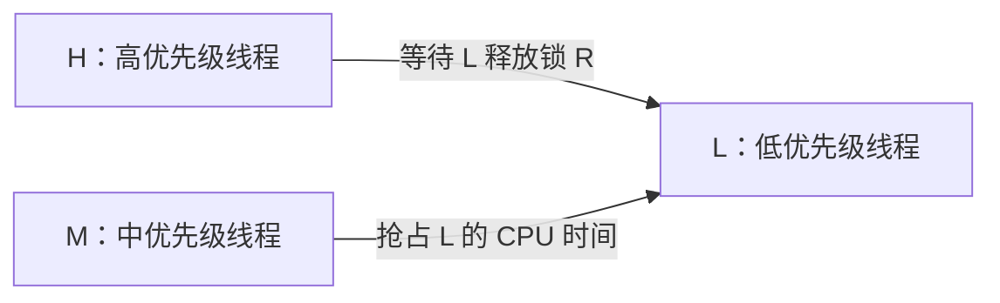
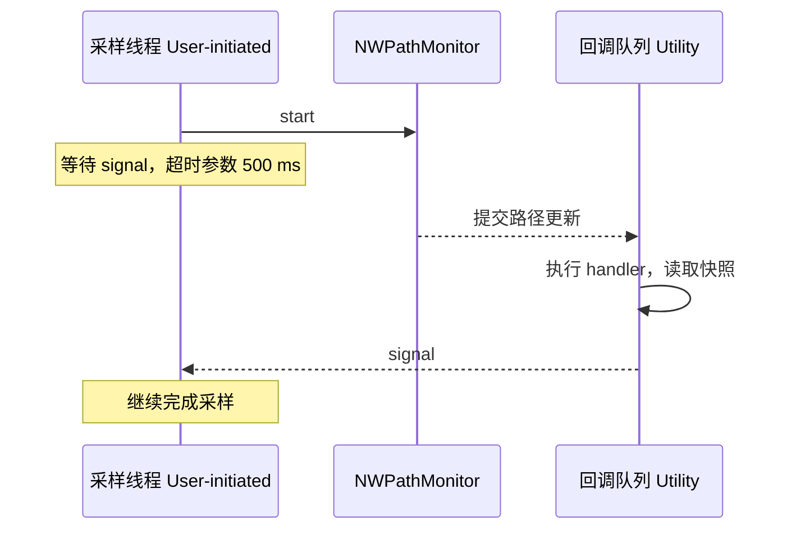

在排查一次 Darwin 网络状态采样问题时，我遇到了 Thread Performance Checker 的优先级反转告警。代码希望更准确地区分 Wi-Fi 和有线网络，于是引入了异步的路径监控接口，又用信号量等待首份结果，让它能接进原有的同步采样流程。

最先暴露问题的是初始化路径。跳过初始化中的等待后，后台采样线程仍然出现相同告警。这说明需要继续追踪等待关系：即使调用者已经在后台，它也可能等待一个优先级更低的回调。

这篇文章主要解释：优先级反转究竟反转在哪里，以及它为什么会出现在这样的异步接口中。

## 1. 问题现象

告警的核心内容如下：

```text
Thread Performance Checker:
Thread running at User-initiated quality-of-service class
waiting on a lower QoS thread running at Utility quality-of-service class.
Investigate ways to avoid priority inversions.
```

网络采样线程的 QoS 是 User-initiated，路径更新回调被安排在 Utility 队列。采样线程启动监控器后，会同步等待回调发出信号，等待超时设置为 500 ms。

500 ms 是这次信号量等待的超时参数，不代表每次都会卡住这么久，也不是整个函数耗时的严格上限。回调即使很快到达，这次跨 QoS 等待也可能被诊断出来。普通功能测试通过，同样不能证明没有这类等待。

## 2. 为什么会引入这个问题

### 2.1 网络类型判断需要更可靠的信息

早期实现可能先通过 Reachability 获得粗分类，再读取 Wi-Fi 信息辅助区分接口。例如，用下面的规则推断当前连接是有线网络：

```text
SSID / BSSID 为空，并且信号信息读不到
    → 当前使用有线网络
```

这个前提并不可靠。Wi-Fi 信息可能因为权限、接口状态或查询错误而缺失，缺失本身不能证明 Ethernet 正在承载流量。不同采样时刻的字段一旦不稳定，还可能把同一条连接识别成网络类型变化。

为此，引入路径监控器来取得路径状态和接口类别。问题出在异步接口与既有同步采样流程的衔接上。

### 2.2 用信号量同步等待异步结果

下面的代码只展示等待关系，省略了路径分类和错误处理：

```objc
dispatch_semaphore_t ready = dispatch_semaphore_create(0);
nw_path_monitor_t monitor = nw_path_monitor_create();

nw_path_monitor_set_queue(
    monitor, dispatch_get_global_queue(QOS_CLASS_UTILITY, 0));

nw_path_monitor_set_update_handler(monitor, ^(nw_path_t path) {
    // 在这里读取已经到达的路径快照。
    dispatch_semaphore_signal(ready);
});

nw_path_monitor_start(monitor);
dispatch_semaphore_wait(
    ready, dispatch_time(DISPATCH_TIME_NOW, 500 * NSEC_PER_MSEC));
nw_path_monitor_cancel(monitor);
```

单看回调，它只是一次网络状态采集，放到 Utility 队列似乎很自然。但调用方正在同步等待它，回调就成了调用方继续执行的必要条件。

初始化和后台定时采样又复用了同一条采集链。因此，跳过首次查询只能移除初始化中的这次等待，后台采样依然可能以 User-initiated 等级等待 Utility 回调。

## 3. 优先级反转究竟是什么

### 3.1 从高、中、低三个优先级的线程看

先看一个经典例子。假设调度器优先运行优先级更高的可运行线程，并且有三个线程：

| 线程 | 优先级 | 当前工作 |
| --- | --- | --- |
| H | 高 | 需要取得锁 R 才能继续 |
| M | 中 | 执行与锁 R 无关的计算 |
| L | 低 | 已持有锁 R，还需要一些 CPU 时间才能释放 |

事情按下面的顺序发生：

1. L 先运行，取得锁 R。
2. H 就绪并抢占 L，但它也需要 R，于是阻塞，等待 L 释放锁。
3. M 就绪。H 已经阻塞，剩下的可运行线程中，M 的优先级高于 L，因此 M 获得 CPU。
4. M 让出 CPU 后，L 才能继续运行并释放锁，H 随后才有机会继续。

等待关系可以画成：



**反转就发生在这里：H 的优先级高于 M，但 H 要等待 L，而 L 又被 M 抢占，结果 H 的推进间接受制于 M。**

H、M、L 的优先级值都没有交换。调度器对可运行线程的选择，也仍然符合优先级顺序；但把资源依赖考虑进来后，高优先级工作反而被较低优先级工作拖住了。

如果中优先级工作持续到来，L 可能迟迟得不到执行机会，H 的等待就会被进一步放大。

### 3.2 为什么没有互斥锁也会出现类似问题

上面的锁例子，清楚地展示了资源持有者和等待者。网络采样中的依赖则来自信号量：



这里，采样线程需要等到低 QoS 回调获得执行机会，才能继续。其他工作如果推迟了 Utility 回调的调度，也会间接延长采样线程的等待。

这张图假设调用者先进入等待；实际运行时，回调也可能先发出信号，让 wait 立即返回。风险来自代码允许建立这条等待依赖，而告警对应的是运行时检测到的等待情形。

Thread Performance Checker 的这条告警，并不要求我们先抓到经典例子中的 M。它已经指出：当前较高 QoS 的工作正在等待较低 QoS 的工作。系统负载升高时，这种依赖可能进一步影响延迟。

### 3.3 Darwin 的 QoS 表达工作的重要程度

Darwin 用 Quality of Service，也就是 QoS，表达工作的延迟和资源需求。常见类别从高到低如下：

| QoS | 典型用途 |
| --- | --- |
| User-interactive | 需要及时响应的交互工作 |
| User-initiated | 用户发起、希望较快得到结果的工作 |
| Default | 没有更明确分类的一般工作 |
| Utility | 可以容忍较长延迟的下载、同步、统计等工作 |
| Background | 对完成时机要求更低的后台维护 |

QoS 并不是固定的 pthread 优先级数值，也不保证严格的执行顺序，系统还会结合其他调度因素处理。前面的三线程例子用来解释等待关系，不能直接当作 Darwin 调度器的完整模型。

“运行在后台线程”和“QoS 是 Background”也是两个不同概念。一个处理用户请求的 worker 完全可能使用 User-initiated，所以把阻塞操作搬到后台，并不自动消除它内部的优先级反转。

同样，QoS 不能用来判断线程身份。看到 User-interactive，不能仅凭这个等级断言它就是 App 主线程；需要结合线程 ID、队列和调用栈确认。

`dispatch_get_global_queue(QOS_CLASS_UTILITY, 0)` 取得的是该等级的全局并发队列，也不意味着所有回调固定在同一条物理线程上执行。

### 3.4 系统为什么不直接提升低优先级线程

一种常见的缓解机制是**优先级继承**。在支持这种机制的锁上，如果 H 等待 L 持有的锁，系统可以临时提升 L 的优先级，让它尽快释放资源，随后再恢复。这样，M 就不容易继续推迟锁的释放。

这依赖于同步原语和操作系统的具体实现，不能假设所有锁和等待操作都有相同的保证。

信号量尤其需要注意：它表达的是计数与唤醒关系，没有一个固定的持有者，任何合适的线程都可以 signal。系统不能仅凭这次 wait，就总能推导出哪一个异步回调应该被提升。因此，不能假设信号量会自动把负责 signal 的回调提升到等待者的 QoS。

给等待加上超时，可以限制这次等待的期限，但不会移除高优先级线程对低优先级回调的依赖。

### 3.5 已有快照的读取，与等待首份快照不同

`NWPathMonitor` 启动后，通过 update handler 异步交付首份和后续路径快照。

拿到 `path` 以后，`nw_path_get_status()`、`nw_path_uses_interface_type()` 等操作是在同步读取已有快照，不需要为了这些 getter 再等待一次回调。真正需要异步完成的是首份状态的到达。

因此，接口名称里有“查询”或“获取”，并不意味着它能同步提供最新状态。衔接异步接口时，需要先确定：调用方需要的是已有缓存，还是必须等到某次异步工作完成。

## 4. 修复：持续监听，读取缓存

最终采用持续监听的方式：在模块生命周期内创建一次 PathMonitor，通过回调异步更新路径状态缓存，采样时直接读取缓存。首份结果未到达时返回 UNKNOWN，收到更新后再通知状态变化。

这样，初始化和后续采样都不需要为了路径状态同步等待回调。后台线程仍然可以采集其他网络信息，PathMonitor 回调也可以按自身工作性质选择 QoS。

UNKNOWN 需要与已经确认断网的状态区分。停止监听时，请求取消、解绑回调入口，并过滤已经排队的迟到结果，不同步等待 worker 或系统回调退出。

将回调 QoS 与调用方对齐，可以缓解固定 Utility 配置造成的等级落差，但仍保留了等待和反复创建监控器的开销。持续监听与缓存消除了这条路径上的同步依赖。

验证时，应检查首回调延迟是否会阻塞初始化、后续更新能否生效，以及停止后的结果是否会被丢弃。功能回归和完整应用中的 Thread Performance Checker 诊断需要分别检查；本次修复针对路径监控的等待，其他系统调用仍需按各自行为评估。

### 公开资料

- [NWPathMonitor](https://developer.apple.com/documentation/network/nwpathmonitor)
- [Diagnosing performance issues early](https://developer.apple.com/documentation/xcode/diagnosing-performance-issues-early)
- [Prioritize Work with Quality of Service Classes](https://developer.apple.com/library/archive/documentation/Performance/Conceptual/EnergyGuide-iOS/PrioritizeWorkWithQoS.html)
